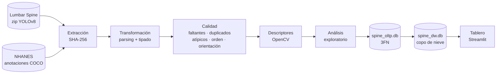
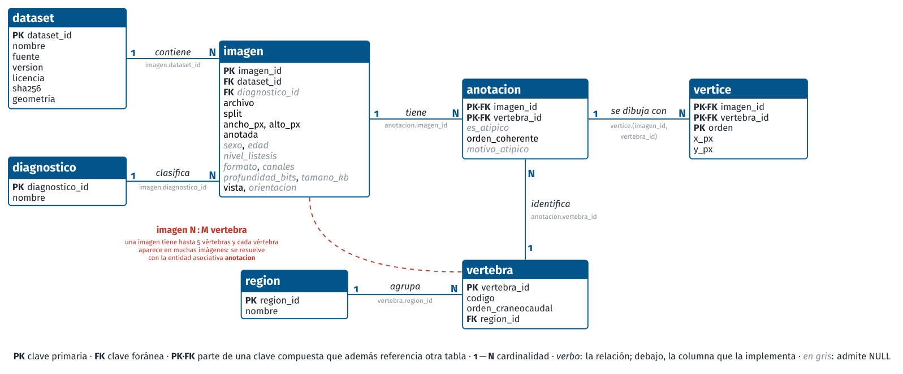
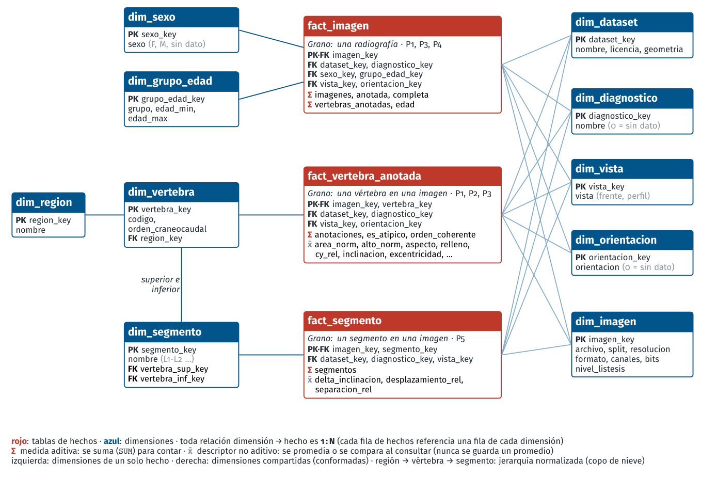

# Curso Introducción a la Ingeniería de Datos

**Alumno:** Marcos Kantor  
**Materia:** (20262Q) DIA.04 — Introducción a la Ingeniería de Datos — Comisión A  
**Institución:** ITBA — Instituto Tecnológico de Buenos Aires  
**Tema de tesis:** Inteligencia artificial para la evaluación de inestabilidad espinal (**SINS**, *Spinal Instability Neoplastic Score*)  
**Dirección de tesis:** Ramiro M. Irastorza (IFLySiB-CONICET) · Marcelo A. Cappelletti (LEICI-CONICET, UNAJ)

---

## Índice

| Entrega | Tema | Archivos | Colab |
|---|---|---|---|
| [Proyecto Final](#proyecto-final) | ¿Alcanzan los datos públicos de radiografías lumbares para entrenar el detector de vértebras de un CDSS de inestabilidad espinal? | [`Proyecto_final.ipynb`](./Proyecto_final.ipynb) · [`app.py`](./app.py) · [`Proyecto_final_defensa.pdf`](./Proyecto_final_defensa.pdf) | [Abrir](https://colab.research.google.com/github/marcoskantor/Curso_Introduccion_Ingenieria_Datos/blob/main/Proyecto_final.ipynb) |
| [TP1](#tp1--ingesta-y-exploración-de-gdelt-20) | Ingesta y exploración de GDELT 2.0 | [`TP1.ipynb`](./TP1.ipynb) | [Abrir](https://colab.research.google.com/github/marcoskantor/Curso_Introduccion_Ingenieria_Datos/blob/main/TP1.ipynb) |
| [TP2](#tp2--modelado-oltp--olap) | Modelado transaccional y dimensional (GDELT / CAMEO) | [`TP2.md`](./TP2.md) · [`TP2.drawio`](./TP2.drawio) | — |
| [TP3](#tp3--análisis-multivariante) | Análisis multivariante del ecosistema global de noticias | [`TP3.ipynb`](./TP3.ipynb) | [Abrir](https://colab.research.google.com/github/marcoskantor/Curso_Introduccion_Ingenieria_Datos/blob/main/TP3.ipynb) |
| [TP4](#tp4--detección-de-eventos-atípicos) | Detección de eventos atípicos en GDELT 2.0 | [`TP4.ipynb`](./TP4.ipynb) | [Abrir](https://colab.research.google.com/github/marcoskantor/Curso_Introduccion_Ingenieria_Datos/blob/main/TP4.ipynb) |

Todos los notebooks se ejecutan en Google Colab con *Entorno de ejecución → Ejecutar todo*, **sin credenciales ni archivos subidos a mano**.

---

# Proyecto Final

## Pregunta de investigación

> **¿Los datos públicos de radiografías lumbares tienen la cobertura, el balance, la calidad geométrica y la coherencia anatómica necesarias para entrenar el detector de vértebras L1–L5 de un sistema de soporte a la decisión clínica (CDSS) orientado al SINS?**

| # | Pregunta de análisis | Responde con |
|---|---|---|
| P1 | ¿Cuántas imágenes tienen L1–L5 completas y qué tan balanceadas están las clases? ¿Alcanza sumando una segunda fuente? | imágenes completas por fuente, anotaciones por vértebra |
| P2 | ¿Qué anotaciones tienen tamaño o forma atípicos para su vértebra? | área relativa a sus vecinas, aspecto, relleno, marca de atípico |
| P3 | ¿Se respeta el orden L1→L5 y el aumento de tamaño hacia caudal? ¿Cómo están orientadas las radiografías? | posición relativa, alto relativo, orden coherente, orientación |
| P4 | ¿Qué diagnósticos, sexos y edades cubre? | imágenes y completas por diagnóstico, sexo y grupo de edad |
| P5 | ¿La inclinación y el desplazamiento medidos con **momentos de imagen (OpenCV)** distinguen las patologías? | inclinación por vértebra, Cobb aproximado, desplazamiento entre vértebras vecinas |

## Entregables

| Componente | Archivo |
|---|---|
| Entregable técnico (Colab reproducible, 14 páginas impreso) | [`Proyecto_final.ipynb`](./Proyecto_final.ipynb): proceso completo, justificaciones y el código que demuestra cada requisito |
| Código auxiliar y DDL | [`src/`](./src/) (extracción, calidad, momentos de OpenCV, carga de las bases, gráficos) y [`sql/`](./sql/) (esquema transaccional comentado columna por columna, almacén y su carga); el cuaderno los clona del repositorio |
| Diagramas | [`docs/img/er_oltp.png`](./docs/img/er_oltp.png) (entidad-relación) y [`docs/img/dw.png`](./docs/img/dw.png) (almacén), generados desde TikZ con [`defensa/diagramas/exportar.py`](./defensa/diagramas/exportar.py) |
| Versión extendida (anexo) | [`notebooks/Proyecto_final_extendido.ipynb`](./notebooks/Proyecto_final_extendido.ipynb): mismo pipeline con el código en línea, análisis exploratorio completo y todas las figuras; genera las mismas bases |
| Tablero interactivo (Streamlit) | [`app.py`](./app.py) — se muestra al final del notebook vía proxy nativo de Colab, con un enlace para abrirlo en una pestaña nueva |
| Presentación de la defensa (PDF, **19 diapositivas para 20 minutos** + 25 de anexo para el coloquio) | [`Proyecto_final_defensa.pdf`](./Proyecto_final_defensa.pdf) — fuente LaTeX en [`defensa/`](./defensa/) (compilar con XeLaTeX); las figuras se regeneran desde el almacén con `python defensa/figuras.py proyecto_final` |
| Datos crudos | [`data/raw/lumbar-spine-vpxwf-v1-yolov8.zip`](./data/raw/lumbar-spine-vpxwf-v1-yolov8.zip) · [`data/raw/nhanes-l1-l5-v1-coco-anotaciones.zip`](./data/raw/nhanes-l1-l5-v1-coco-anotaciones.zip) |

## Datos

Dos fuentes públicas (CC BY 4.0), descargadas por URL pública de este repositorio y verificadas por **SHA-256** (Roboflow exige API key):

| | Lumbar Spine (principal) | NHANES L1–L5 (segunda fuente) |
|---|---|---|
| Origen | [rp-team/lumbar-spine-vpxwf](https://universe.roboflow.com/rp-team/lumbar-spine-vpxwf) v1 | [main-kybbe/roboflow_nhanes_l1_to_l5_detection](https://universe.roboflow.com/main-kybbe/roboflow_nhanes_l1_to_l5_detection-npahn) v1 |
| Imágenes | 50 radiografías (34 anotadas), frente y perfil | 4.436 radiografías de perfil (encuesta de salud NHANES, EE. UU.) |
| Anotación | polígonos L1–L5 | cajas L1–L5 (estiradas a 640×640) |
| Metadatos | diagnóstico, sexo y edad en el nombre de archivo | — |
| Copia en el repo | zip YOLOv8 completo | sólo las anotaciones COCO (542 KB) |
| Responde | P1–P5 | P1 y P3 (las cajas no tienen forma ni inclinación) |

Detalle de la fuente principal:

| Campo | Valor |
|---|---|
| Origen | [rp-team/lumbar-spine-vpxwf](https://universe.roboflow.com/rp-team/lumbar-spine-vpxwf), versión 1 |
| Tarea | Segmentación de instancias (polígonos) en radiografías |
| Formato | Export YOLOv8 crudo |
| Clases | L1, L2, L3, L4, L5 |
| Licencia | CC BY 4.0 (permite redistribuir citando la fuente) |
| Contenido | 50 radiografías (34 anotadas), 170 polígonos; diagnóstico, sexo y edad codificados en el nombre de archivo |
| Acceso | Copia sin modificar en este repositorio, descargada por URL pública y verificada por **SHA-256** (Roboflow exige API key) |

## Pipeline

| Etapa | Qué se hace | Artefacto |
|---|---|---|
| Extracción | Dos fuentes por URL pública, verificación SHA-256, idempotente | 2 zips crudos |
| Transformación | Inventario por imagen, metadatos clínicos por expresiones regulares, parsing de polígonos (fórmula de Gauss), carga optimizada (`usecols` + tipado) | staging CSV |
| Calidad | Nulos clasificados como **estructurales** (no aplican o la fuente no los registra) o **perdidos** (deberían existir), con una decisión por caso; ceros reales separados de los que codificaban «no evaluado» (pasan a NULL); orientación de cada radiografía (vertical / girada 90° / invertida), duplicados (imagen, vértebra), inválidos geométricos, atípicos (Shapiro-Wilk → Tukey 2·IQR, Mahalanobis robusta) sobre variables normalizadas por imagen, control del orden craneocaudal L1→L5 | marcas de calidad |
| Descriptores OpenCV | Momentos de cada contorno (`cv2.moments`): área, centroide, **inclinación** por momentos centrales, excentricidad, circularidad, solidez, momentos de Hu; formato de píxel (formato, canales, bits) e intensidad y contraste dentro de cada polígono; segmentos intervertebrales y Cobb aproximado | columnas nuevas |
| Análisis exploratorio | Resoluciones y vértebras por imagen en las dos fuentes, matriz de correlación de Spearman de los descriptores, ACP (varianza explicada y biplot por vértebra y por diagnóstico), vectores de medias por diagnóstico y distancias entre perfiles, ejemplos de orientación en NHANES | figuras en el notebook |
| Carga transaccional | SQLite en 3FN: `dataset`, `diagnostico`, `region`, `vertebra`, `imagen`, `anotacion` (entidad asociativa de la N:M imagen–vértebra, PK compuesta) y `vertice` (PK compuesta) | `spine_oltp.db` |
| Almacén | Diseñado desde las preguntas «¿cuántos … por …?»: **tres tablas de hechos** con dimensiones compartidas (constelación) — `fact_imagen` (grano radiografía), `fact_vertebra_anotada` (vértebra en una imagen) y `fact_segmento` (segmento) —, medidas aditivas (conteos y marcas 0/1) y la jerarquía `dim_region → dim_vertebra → dim_segmento` normalizada (copo de nieve) | `spine_dw.db` |
| Visualización | Tablero con veredicto ajustable, cobertura imagen × vértebra, balance, progresión anatómica, atípicos, representatividad y alineación (P5) | `app.py` |

### Modelo transaccional (`spine_oltp.db`)

| Relación | Cardinalidad | Llave que la implementa |
|---|---|---|
| `dataset` → `imagen` | 1 : N (una fuente, muchas radiografías) | `imagen.dataset_id` |
| `diagnostico` → `imagen` | 1 : N (a lo sumo un diagnóstico por radiografía; NULL en NHANES) | `imagen.diagnostico_id` |
| `region` → `vertebra` | 1 : N | `vertebra.region_id` |
| `imagen` ↔ `vertebra` | **N : M** (hasta 5 vértebras por imagen; cada vértebra en miles de imágenes) | entidad asociativa `anotacion`, PK `(imagen_id, vertebra_id)` |
| `anotacion` → `vertice` | 1 : N (3 o más vértices; 4 en las cajas) | `vertice.(imagen_id, vertebra_id)` |

Cada columna está comentada en [`sql/oltp.sql`](./sql/oltp.sql): qué es, de qué variable de la fuente sale (nombre de archivo, línea YOLOv8, anotación COCO, cabecera de la imagen o cálculo del ETL) y, si admite NULL, si el nulo es estructural o perdido.

### Almacén (`spine_dw.db`): tres hechos que responden «¿cuántos … por …?»

| | ¿Cuántos … | … por …? (dimensiones) | Medida | Hecho |
|---|---|---|---|---|
| P1 | imágenes completas L1–L5; anotaciones | fuente; vértebra | `SUM(completa)`; `SUM(anotaciones)` | `fact_imagen`; `fact_vertebra_anotada` |
| P2 | anotaciones de forma atípica | vértebra | `SUM(es_atipico)` | `fact_vertebra_anotada` |
| P3 | anotaciones fuera de orden; imágenes | vértebra, fuente; orientación, fuente | `SUM(1 − orden_coherente)`; `SUM(imagenes)` | `fact_vertebra_anotada`; `fact_imagen` |
| P4 | imágenes y completas | diagnóstico, sexo, grupo de edad | `SUM(imagenes)`, `SUM(completa)` | `fact_imagen` |
| P5 | grados de inclinación (Cobb = MAX − MIN) | diagnóstico, vista, segmento | `inclinacion`, `delta_inclinacion` (se promedian) | `fact_vertebra_anotada`, `fact_segmento` |

**Grano y medidas del almacén.** `fact_imagen` = una radiografía; `fact_vertebra_anotada` = una vértebra anotada en una imagen; `fact_segmento` = un segmento intervertebral en una imagen. Las medidas aditivas son conteos (`imagenes`, `anotaciones`, `segmentos`) y marcas 0/1 (`anotada`, `completa`, `es_atipico`, `orden_coherente`), que se suman; los descriptores geométricos se guardan atómicos y se promedian al consultar (no se guardan promedios). Diagnóstico, sexo, grupo de edad y orientación tienen el miembro «sin dato» (clave 0): un faltante se cuenta como categoría y nunca como 0. No hay dimensión tiempo: las radiografías no tienen fecha. El ACP del análisis exploratorio usa **todas** las vértebras con polígono (169); el único *sample* (200 imágenes) es sólo para graficar en el tablero.

### Correcciones de la defensa (25/11/2026)

- **Modelo entidad-relación:** diagrama nuevo con todos los atributos, PK y FK, la cardinalidad de cada relación y la columna que la implementa (p. ej. `dataset` 1:N `imagen` por `imagen.dataset_id`); la relación N:M imagen–vértebra se muestra resuelta por la entidad asociativa `anotacion`. `geometria` pasó de `anotacion` a `dataset` (dependía sólo de la fuente). Diccionario «variable de la fuente → atributo» en el cuaderno y en el DDL.
- **Almacén:** rediseñado desde las preguntas: cada «por» es una dimensión y cada «cuántos» una medida aditiva. Se agregó `fact_imagen` (P1, P3 y P4 se respondían consultando una dimensión) y las dimensiones `dim_sexo`, `dim_grupo_edad`, `dim_vista` y `dim_orientacion`, compartidas por los hechos.
- **Nulos y ceros:** cada faltante se clasifica como estructural o perdido, con su decisión (descartar, imputar con parecidos o conservar marcado). Se corrigieron dos ceros que eran nulos: `es_atipico = 0` en las cajas de NHANES (no evaluadas → NULL) y «0 mujeres» en NHANES (sexo «sin dato»).

## Resultados

| Indicador | Valor |
|---|---|
| Imágenes completas L1–L5 | 33 (Lumbar Spine) + 4.405 (NHANES) = **4.438** |
| Radiografías de NHANES giradas o invertidas | 477 (11 %) |
| Razón máx/mín entre clases | 1,03 |
| Anotaciones atípicas | 5 de 169 (3 %) |
| Violaciones del orden L1→L5 | 0 |
| Cobb aproximado (mediana), escoliosis vs. normales | 36° vs. 7° (Mann-Whitney, p < 0,001) |
| Componentes principales para el 80 % de la varianza de forma | 4 de 12 |
| Perfil más alejado de la columna normal | espondilolistesis (distancia 3,84) |

**Veredicto:** Lumbar Spine sola **no alcanza** (33 imágenes completas). Sumando NHANES, los datos públicos **sí alcanzan para entrenar** el detector, con dos condiciones que dejó a la vista el control de calidad: **normalizar la orientación** (11 % de NHANES girada o invertida) y **sumar vistas de frente**, que hoy sólo aporta Lumbar Spine. Las 16 imágenes sin anotar son todas de escoliosis o del código «S»: el faltante no es aleatorio. El análisis exploratorio mostró que excentricidad, circularidad y Hu miden lo mismo (|ρ| = 1), que la forma no distingue el nivel vertebral (lo da la posición) y que la espondilolistesis se separa por ser radiografías de perfil: la vista es una variable de primer orden. Con los momentos de imagen, los contornos ya permiten medir alineación: el Cobb aproximado separa las columnas escolióticas de las normales, un primer paso hacia el criterio de alineación del SINS.

---

# TP1 — Ingesta y exploración de GDELT 2.0

Ingesta de un día de la tabla de eventos de GDELT 2.0 a partir de `masterfilelist.txt` (~96 archivos de 15 minutos), descarga en paralelo con `ThreadPoolExecutor`, lectura directa desde el ZIP y cálculo de métricas diarias, con gráficos de evolución temporal y un mapa por país.

Cuaderno: [`TP1.ipynb`](./TP1.ipynb)

---

# TP2 — Modelado OLTP + OLAP

Diseño de una base transaccional y un almacén de datos sobre GDELT 2.0 / CAMEO para responder cuatro preguntas del negocio periodístico: rendimiento e impacto (P1), sentimiento por tipo de actor (P2), frecuencia y temporalidad (P3) y cobertura multi-temática (P4).

- **Modelo entidad-relación:** una sola clave por entidad; tres claves foráneas de ubicación (Actor1Geo, Actor2Geo, ActionGeo); las relaciones M:N evento–código CAMEO y evento–artículo se resuelven con los puentes `Evento_CAMEO` y `Mencion`, de clave compuesta.
- **Esquema estrella:** `Fact_Cobertura` con grano día × país × tipo de actor × tema y **PK compuesta por sus dimensiones** (`Dim_Tiempo`, `Dim_Geografia`, `Dim_Tipo_Actor`, `Dim_Tema`); puente `Puente_Evento_Tema` para P4. Métricas aditivas, cada una vinculada a una pregunta.
- Incluye el script SQL y las consultas de P1–P4. La sección 0 del documento detalla las correcciones aplicadas a partir de la devolución del docente.

Archivos: [`TP2.md`](./TP2.md) · [`TP2.drawio`](./TP2.drawio)

---

# TP3 — Análisis multivariante

Caracterización del ecosistema global de noticias con GDELT 2.0: extensión del almacén con actores, tipo de interacción, región, tono y escala Goldstein; vectores de medias por país, distancias entre países, matrices de correlación y Análisis de Componentes Principales con interpretación de las cargas.

Correcciones de la devolución docente: el almacén guarda **sumas y conteos** (no promedios) y la dimensión tiempo es **por día** (semana ISO y mes derivados; 31 días); el prompt a la IA es **guiado** (contexto, grano, medidas y consultas esperadas); la **muestra del 10 %** del ACP se justifica con números (2,96 M de eventos, 0,90 GB por copia de la matriz) y se prueba su estabilidad contra un 5 % (varianza explicada y loadings prácticamente idénticos); el top 10 de países sale del almacén (población completa) y la exclusión de las dummies de país se justifica porque son la variable de agrupamiento.

Cuaderno: [`TP3.ipynb`](./TP3.ipynb)

---

# TP4 — Detección de eventos atípicos

Búsqueda de eventos "raros" en la tabla de eventos de GDELT 2.0 de los últimos 7 días.

| Etapa | Qué se hace |
|---|---|
| Ingesta | Archivos de 15 minutos desde `masterfilelist.txt`, verificación MD5, One Big Table desnormalizada con los libros de códigos CAMEO/FIPS, guardada en Parquet |
| Nulos y ceros | Faltantes estructurales (evento sin Actor2) vs. reales, auditoría de consistencia lógica del codebook, imputación justificada por variable; `AvgTone = 0` exacto identificado como pico anómalo (tono no calculado) y tratado como faltante, a diferencia de `GoldsteinScale = 0`, que es un valor CAMEO válido |
| Cardinalidad y dummies | Categorías con menos del 5 % → `OTHER`; variables indicadoras con categoría de referencia; control de varianza casi nula |
| Diseño de variables | Noticias retrospectivas (fechas "hace un año" inferidas por GDELT) separadas como hallazgo de calidad; conteos en percentiles; ubicación sólo como país; variantes probadas y documentadas |
| ACP | Escalado robusto (`RobustScaler`: mediana y RIC) y selección del número mínimo de componentes (varianza acumulada, Kaiser generalizado, codo) |
| Atípicos | 10 métodos de 6 familias: distancia global (Z-score, Tukey), T² de Hotelling, SPE, K-Means, k-NN, LOF, DBSCAN, Isolation Forest y autoencoder; acuerdo por Jaccard y consenso por mayoría; tipología de cada atípico y tabla agrupada por noticia; exportación a Parquet/CSV |

Cuaderno: [`TP4.ipynb`](./TP4.ipynb)

---

# Estructura del repositorio

    Curso_Introduccion_Ingenieria_Datos/
    ├── Proyecto_final.ipynb          # Entregable técnico del proyecto final
    ├── src/                          # Módulos del proyecto final (extracción, calidad, forma, almacén, gráficos)
    ├── sql/                          # DDL de la base transaccional y del almacén
    ├── app.py                        # Tablero Streamlit
    ├── Proyecto_final_defensa.pdf    # Presentación de la defensa
    ├── defensa/                      # Fuente LaTeX (Beamer), figuras y diagramas TikZ (diagramas/) de la defensa
    ├── docs/img/                     # Diagramas ER y del almacén (PNG) que muestran el cuaderno y este README
    ├── data/raw/                     # Datos crudos del proyecto final (CC BY 4.0): Lumbar Spine y NHANES
    ├── TP1.ipynb                  # TP1
    ├── TP2.md · TP2.drawio           # TP2
    ├── TP3.ipynb                     # TP3
    ├── TP4.ipynb                     # TP4
    ├── notebooks/                    # Versión extendida del proyecto final y notebook de configuración
    ├── requirements.txt
    └── README.md

> Las bases `.db`, los archivos de staging y las descargas de GDELT **no se versionan**: se regeneran al ejecutar los notebooks.

---

# Cómo reproducir

1. Abrir el notebook en Colab con el botón **Abrir** de la tabla del índice.
2. Ejecutar *Entorno de ejecución → Ejecutar todo*. No hace falta ninguna credencial.
3. En el proyecto final, el tablero aparece al final del notebook. Fuera de Colab: `pip install -r requirements.txt` y `streamlit run app.py` en la carpeta de trabajo que crea el notebook.

---

# Declaración de uso de IA

**Proyecto final**

- **"Claude Opus 5.5"** para "generar y revisar el código Python del cuaderno, redactar el borrador de las celdas Markdown y de la presentación de la defensa, y revisar los gráficos con criterios de *storytelling*".

Se usó a través de Claude Code (Anthropic); no se usó ninguna otra herramienta de IA. Cada trabajo práctico incluye su propia declaración y su guía de instrucciones (*human-in-the-loop*) dentro del notebook.

Los pedidos a la IA se formularon como **prompts guiados**: contexto (qué es cada entidad y cómo se relacionan), grano de cada tabla de hechos y pedido concreto (por ejemplo, «Creá las consultas para este diseño de almacén de datos»), en lugar de pedidos vagos. Los ejemplos están en la sección «Instrucciones de la IA» del proyecto final y en el anexo B19 de la defensa.

Las decisiones metodológicas fueron definidas y validadas por el autor.

---

**ITBA** · 2026  
*Introducción a la Ingeniería de Datos — Comisión A*

