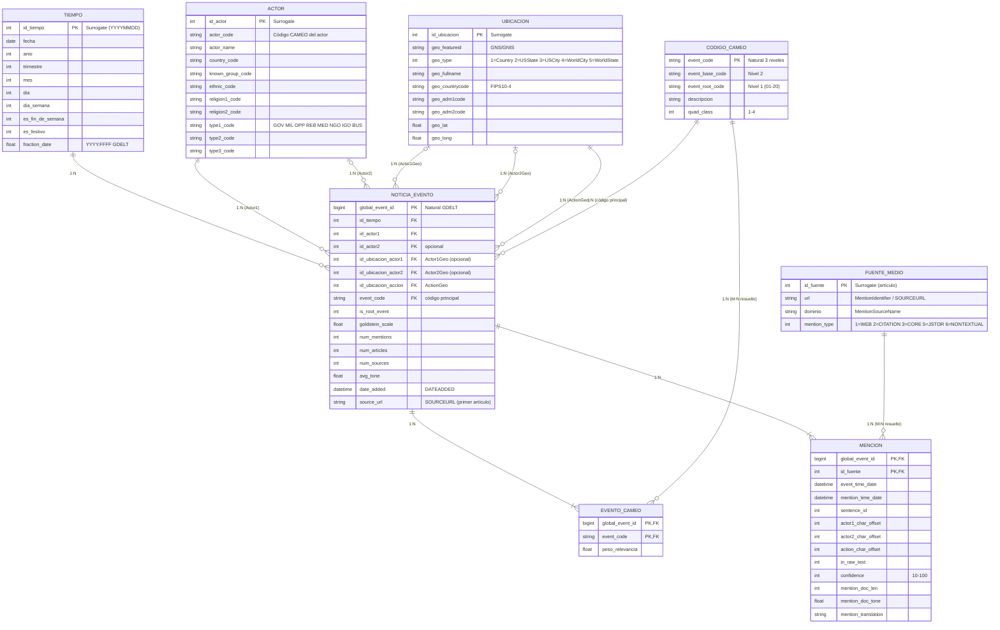
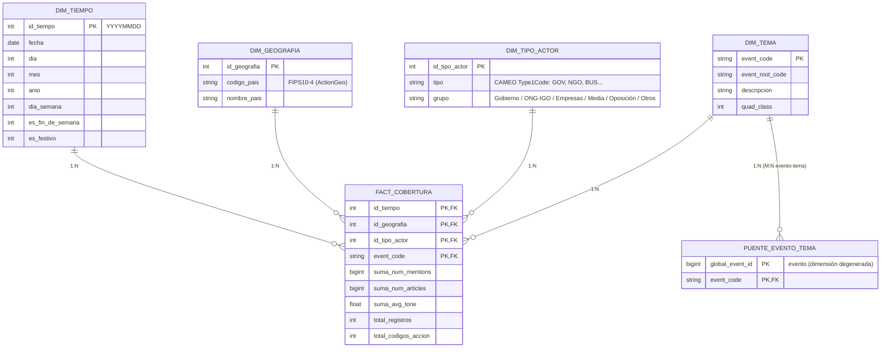
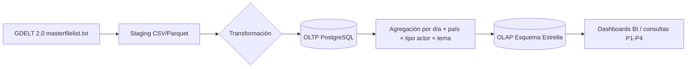
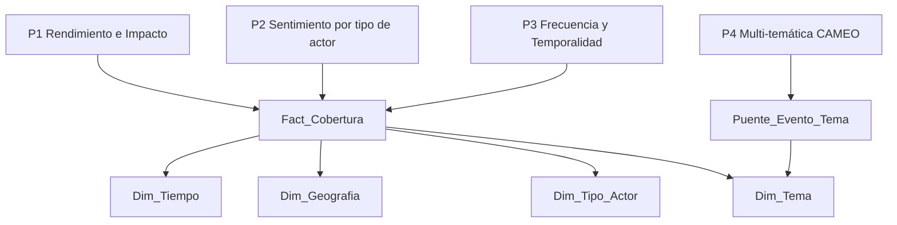

# TP2 — Bases de Datos: Diseño OLTP + OLAP (GDELT / CAMEO)

**Alumno:** Marcos Kantor  
**Comisión:** A  
**Materia:** Introducción a la Ingeniería de Datos  
**Fecha:** 25/09/2026 — **Revisión:** 15/10/2026 (correcciones del docente)

**Aclaración de IA:** Utilicé Claude (Anthropic) como asistente para estructurar los modelos ER/Estrella, generar los diagramas en Mermaid y el script SQL inicial. En la revisión utilicé Claude Opus 5.5 para aplicar las correcciones indicadas por el docente al modelo ER, al esquema estrella, al script SQL y al diagrama draw.io.

---

## 0) Correcciones aplicadas en esta revisión

| # | Observación del docente | Corrección aplicada |
|---|---|---|
| 1 | En el ER se usan UK y PK; debe ir uno solo | Cada entidad tiene **una única llave: la PK**. Se eliminaron todas las UK. `Noticia_Evento` y `Codigo_CAMEO` usan su llave natural como PK (`global_event_id`, `event_code`); `Actor`, `Ubicacion`, `Fuente_Medio` y `Tiempo` usan una PK sustituta y sus códigos naturales quedan como atributos. |
| 2 | La ubicación se debe asignar a Actor1, Actor2 y Action | `Noticia_Evento` tiene **tres FK** a `Ubicacion`: `id_ubicacion_actor1`, `id_ubicacion_actor2` e `id_ubicacion_accion` (Actor1Geo, Actor2Geo y ActionGeo). |
| 3 | `Mencion` no es 1:N, es M:N; debe usar un puente | Un evento se menciona en muchos artículos y un artículo menciona muchos eventos. `Mencion` pasa a ser la **tabla puente** entre `Noticia_Evento` y `Fuente_Medio` (artículo). |
| 4 | El puente `Evento_CAMEO` no puede tener llave única; debe ser compuesta | Se eliminó el surrogate `id_evento_cameo`. PK **compuesta** `(global_event_id, event_code)`. Lo mismo para `Mencion`: PK `(global_event_id, id_fuente)`. |
| 5 | En la FACT la PK debe ser compuesta a partir de las dimensiones | Se eliminó `id_fact`. PK de `Fact_Cobertura` = `(id_tiempo, id_geografia, id_tipo_actor, event_code)`. |
| 6 | ¿De dónde sale `confidence_prom`? Dimensiones y métricas deben responder las preguntas | `confidence_prom` salía del campo `Confidence` de la tabla *Mentions* y **no responde ninguna pregunta**: se eliminó. También se quitaron las métricas y dimensiones que ninguna pregunta usa (`goldstein`, `num_sources`, `Dim_Fuente`). Cada dimensión y cada métrica que queda está vinculada a una pregunta (sección 2). |

---

## 1) Modelo OLTP — Entidad-Relación (CAMEO/GDELT)



### Justificación de llaves

Cada entidad tiene **una sola llave (PK)**; no se definen llaves únicas adicionales.

| Entidad | PK | Tipo | Motivo |
|---|---|---|---|
| Noticia_Evento | `global_event_id` | Natural | GDELT garantiza que GlobalEventID es único y estable; no hace falta un sustituto |
| Codigo_CAMEO | `event_code` | Natural | Código corto, semántico y estable |
| Actor | `id_actor` | Sustituta | El código CAMEO del actor no identifica unívocamente al actor (se repite con distintos nombres, tipos, grupos) |
| Ubicacion | `id_ubicacion` | Sustituta | `Geo_FeatureID` puede faltar (p.ej. ubicaciones de nivel país) |
| Fuente_Medio | `id_fuente` | Sustituta | La URL es larga y no apta como llave de JOIN |
| Tiempo | `id_tiempo` | Sustituta | Entero YYYYMMDD, eficiente para JOIN y legible |
| Evento_CAMEO (puente) | `(global_event_id, event_code)` | Compuesta | Formada por las PK de las dos tablas que conecta |
| Mencion (puente) | `(global_event_id, id_fuente)` | Compuesta | Formada por las PK de las dos tablas que conecta |

### Tipos de relaciones

- `Noticia_Evento` **N:1** `Tiempo` — obligatoria.
- `Noticia_Evento` **N:1** `Actor` — dos FK (rol Actor1 obligatorio, rol Actor2 opcional).
- `Noticia_Evento` **N:1** `Ubicacion` — **tres FK**, una por rol: Actor1Geo, Actor2Geo (opcionales) y ActionGeo (obligatoria).
- `Noticia_Evento` **N:1** `Codigo_CAMEO` — código de acción principal del evento.
- `Noticia_Evento` **M:N** `Codigo_CAMEO` — resuelta por el puente `Evento_CAMEO` (un evento puede clasificarse con varios códigos y un código aplica a muchos eventos).
- `Noticia_Evento` **M:N** `Fuente_Medio` — resuelta por el puente `Mencion` (un evento se menciona en muchos artículos y un artículo menciona muchos eventos). Los atributos de la mención (confianza, tono del documento, offsets) son atributos de la relación y viven en el puente.

---

## 2) Modelo OLAP — Esquema Estrella

### Preguntas de diseño → dimensiones y métricas

| Pregunta del negocio | Dimensiones que usa | Métricas que usa |
|---|---|---|
| **P1 — Rendimiento e impacto:** ¿qué noticias y temas generan mayor volumen de menciones y publicaciones por país y mes? | `Dim_Geografia` (país), `Dim_Tiempo` (mes, año), `Dim_Tema` | `suma_num_mentions`, `suma_num_articles` |
| **P2 — Sentimiento de la cobertura:** ¿cómo varía el tono promedio según el tipo de actor involucrado (Gobierno, ONG, Empresas)? | `Dim_Tipo_Actor` | `suma_avg_tone`, `total_registros` → tono promedio = `suma_avg_tone / total_registros` |
| **P3 — Frecuencia y temporalidad:** ¿cómo cambia la intensidad del flujo de noticias entre días hábiles, fines de semana y festivos? | `Dim_Tiempo` (día, es_fin_de_semana, es_festivo) | `total_registros`, `suma_num_articles` |
| **P4 — Cobertura multi-temática:** ¿qué eventos requirieron clasificación bajo múltiples códigos de acción en una misma cobertura? | `Dim_Tema` + `Puente_Evento_Tema` | `total_codigos_accion` |

Granularidad (*grain*) de la tabla de hechos: **un registro por día × país × tipo de actor × tema (código CAMEO principal)**. Por eso la PK es la combinación de las cuatro dimensiones.



### Métricas de la tabla de hechos

Todas las métricas son **aditivas** (sumas y conteos), por lo que pueden agregarse por cualquier combinación de dimensiones. Los promedios se calculan en la consulta dividiendo sumas por conteos, nunca se almacenan promedios (un promedio de promedios es incorrecto).

| Métrica | Origen (GDELT Event) | Cálculo en el ETL | Pregunta |
|---|---|---|---|
| `suma_num_mentions` | NumMentions | `SUM(NumMentions)` | P1 |
| `suma_num_articles` | NumArticles | `SUM(NumArticles)` | P1, P3 |
| `suma_avg_tone` | AvgTone | `SUM(AvgTone)` → tono promedio = `suma_avg_tone / total_registros` | P2 |
| `total_registros` | GlobalEventID | `COUNT(*)` eventos | P2, P3 |
| `total_codigos_accion` | Puente Evento–Tema | `SUM(códigos CAMEO distintos por evento)` | P4 |

### Dimensión Temporal

Atributos **Día, Mes, Año, Día_Semana, Es_Fin_De_Semana, Es_Festivo**. Responde P1 (agrupación mensual) y P3 (días hábiles vs. fines de semana vs. festivos).

### Dimensión Tipo de Actor (P2)

Se usa el tipo del **Actor1** (el actor que inicia la acción). El atributo `grupo` agrupa los códigos CAMEO en las categorías que pide la pregunta:

| Grupo | Códigos CAMEO en `Actor1Type1Code` |
|---|---|
| Gobierno | GOV, COP, JUD, MIL, SPY |
| ONG / IGO | IGO, NGO, NGM |
| Empresas | MNC, BUS |
| Media | MED |
| Oposición / Rebeldes | OPP, REB, SEP, INS |
| Otros | EDU, HLH, HRI, LAB, REF, ELI y sin tipo |

### Tabla Puente `Puente_Evento_Tema` (P4)

Resuelve la relación **M:N** entre eventos y códigos CAMEO. Su PK es **compuesta** `(global_event_id, event_code)`: la forman las llaves de lo que conecta. Permite que una misma noticia se filtre o agrupe por múltiples códigos CAMEO **sin duplicar** `NumMentions` ni `NumArticles` en la tabla de hechos (los volúmenes se cargan una sola vez, bajo el código principal).

---

## 3) Flujo ETL



---

## 4) Preguntas del negocio → modelo dimensional



---

## 5) Script SQL (SQLite / PostgreSQL)

```sql
-- ================== OLTP ==================
CREATE TABLE Tiempo (
  id_tiempo        INTEGER PRIMARY KEY,          -- YYYYMMDD
  fecha            DATE,
  anio             INT,
  trimestre        INT,
  mes              INT,
  dia              INT,
  dia_semana       INT,
  es_fin_de_semana INT,
  es_festivo       INT,
  fraction_date    REAL
);

CREATE TABLE Actor (
  id_actor         INTEGER PRIMARY KEY,
  actor_code       TEXT,
  actor_name       TEXT,
  country_code     TEXT,
  known_group_code TEXT,
  ethnic_code      TEXT,
  religion1_code   TEXT,
  religion2_code   TEXT,
  type1_code       TEXT,
  type2_code       TEXT,
  type3_code       TEXT
);

CREATE TABLE Ubicacion (
  id_ubicacion     INTEGER PRIMARY KEY,
  geo_featureid    TEXT,
  geo_type         INT,
  geo_fullname     TEXT,
  geo_countrycode  TEXT,
  geo_adm1code     TEXT,
  geo_adm2code     TEXT,
  geo_lat          REAL,
  geo_long         REAL
);

CREATE TABLE Fuente_Medio (
  id_fuente    INTEGER PRIMARY KEY,
  url          TEXT,
  dominio      TEXT,
  mention_type INT
);

CREATE TABLE Codigo_CAMEO (
  event_code      TEXT PRIMARY KEY,
  event_base_code TEXT,
  event_root_code TEXT,
  descripcion     TEXT,
  quad_class      INT
);

CREATE TABLE Noticia_Evento (
  global_event_id     BIGINT PRIMARY KEY,
  id_tiempo           INT  NOT NULL REFERENCES Tiempo(id_tiempo),
  id_actor1           INT  NOT NULL REFERENCES Actor(id_actor),
  id_actor2           INT           REFERENCES Actor(id_actor),
  id_ubicacion_actor1 INT           REFERENCES Ubicacion(id_ubicacion),
  id_ubicacion_actor2 INT           REFERENCES Ubicacion(id_ubicacion),
  id_ubicacion_accion INT  NOT NULL REFERENCES Ubicacion(id_ubicacion),
  event_code          TEXT NOT NULL REFERENCES Codigo_CAMEO(event_code),
  is_root_event       INT,
  goldstein_scale     REAL,
  num_mentions        INT,
  num_articles        INT,
  num_sources         INT,
  avg_tone            REAL,
  date_added          TIMESTAMP,
  source_url          TEXT
);

-- Puente M:N evento <-> código CAMEO
CREATE TABLE Evento_CAMEO (
  global_event_id BIGINT REFERENCES Noticia_Evento(global_event_id),
  event_code      TEXT   REFERENCES Codigo_CAMEO(event_code),
  peso_relevancia REAL,
  PRIMARY KEY (global_event_id, event_code)
);

-- Puente M:N evento <-> artículo (fuente)
CREATE TABLE Mencion (
  global_event_id     BIGINT REFERENCES Noticia_Evento(global_event_id),
  id_fuente           INT    REFERENCES Fuente_Medio(id_fuente),
  event_time_date     TIMESTAMP,
  mention_time_date   TIMESTAMP,
  sentence_id         INT,
  actor1_char_offset  INT,
  actor2_char_offset  INT,
  action_char_offset  INT,
  in_raw_text         INT,
  confidence          INT,
  mention_doc_len     INT,
  mention_doc_tone    REAL,
  mention_translation TEXT,
  PRIMARY KEY (global_event_id, id_fuente)
);

-- ================== OLAP ==================
CREATE TABLE Dim_Tiempo (
  id_tiempo        INTEGER PRIMARY KEY,          -- YYYYMMDD
  fecha            DATE,
  dia              INT,
  mes              INT,
  anio             INT,
  dia_semana       INT,
  es_fin_de_semana INT,
  es_festivo       INT
);

CREATE TABLE Dim_Geografia (
  id_geografia INTEGER PRIMARY KEY,
  codigo_pais  TEXT,
  nombre_pais  TEXT
);

CREATE TABLE Dim_Tipo_Actor (
  id_tipo_actor INTEGER PRIMARY KEY,
  tipo          TEXT,
  grupo         TEXT
);

CREATE TABLE Dim_Tema (
  event_code      TEXT PRIMARY KEY,
  event_root_code TEXT,
  descripcion     TEXT,
  quad_class      INT
);

CREATE TABLE Fact_Cobertura (
  id_tiempo            INT    REFERENCES Dim_Tiempo(id_tiempo),
  id_geografia         INT    REFERENCES Dim_Geografia(id_geografia),
  id_tipo_actor        INT    REFERENCES Dim_Tipo_Actor(id_tipo_actor),
  event_code           TEXT   REFERENCES Dim_Tema(event_code),
  suma_num_mentions    BIGINT,
  suma_num_articles    BIGINT,
  suma_avg_tone        REAL,
  total_registros      INT,
  total_codigos_accion INT,
  PRIMARY KEY (id_tiempo, id_geografia, id_tipo_actor, event_code)
);

CREATE TABLE Puente_Evento_Tema (
  global_event_id BIGINT,
  event_code      TEXT REFERENCES Dim_Tema(event_code),
  PRIMARY KEY (global_event_id, event_code)
);

-- Índices (la PK compuesta ya indexa por id_tiempo como primer componente)
CREATE INDEX idx_fact_geo    ON Fact_Cobertura(id_geografia);
CREATE INDEX idx_fact_actor  ON Fact_Cobertura(id_tipo_actor);
CREATE INDEX idx_fact_tema   ON Fact_Cobertura(event_code);
CREATE INDEX idx_puente_tema ON Puente_Evento_Tema(event_code);
CREATE INDEX idx_mencion_fte ON Mencion(id_fuente);
CREATE INDEX idx_evcameo_cod ON Evento_CAMEO(event_code);
```

### Consultas de las preguntas del negocio

```sql
-- P1: temas con mayor volumen de menciones y artículos por país y mes
SELECT dg.nombre_pais, dt.anio, dt.mes, tm.descripcion AS tema,
       SUM(f.suma_num_mentions) AS total_menciones,
       SUM(f.suma_num_articles) AS total_articulos
FROM Fact_Cobertura f
JOIN Dim_Geografia dg ON dg.id_geografia = f.id_geografia
JOIN Dim_Tiempo    dt ON dt.id_tiempo    = f.id_tiempo
JOIN Dim_Tema      tm ON tm.event_code   = f.event_code
GROUP BY dg.nombre_pais, dt.anio, dt.mes, tm.descripcion
ORDER BY total_menciones DESC;

-- P2: tono promedio de la cobertura por tipo de actor
SELECT da.grupo,
       SUM(f.suma_avg_tone) / SUM(f.total_registros) AS tono_promedio
FROM Fact_Cobertura f
JOIN Dim_Tipo_Actor da ON da.id_tipo_actor = f.id_tipo_actor
GROUP BY da.grupo
ORDER BY tono_promedio;

-- P3: intensidad del flujo de noticias por tipo de día
SELECT CASE WHEN dt.es_festivo = 1       THEN 'Festivo'
            WHEN dt.es_fin_de_semana = 1 THEN 'Fin de semana'
            ELSE 'Día hábil' END AS tipo_dia,
       SUM(f.total_registros) * 1.0 / COUNT(DISTINCT dt.id_tiempo) AS eventos_por_dia,
       SUM(f.suma_num_articles) * 1.0 / COUNT(DISTINCT dt.id_tiempo) AS articulos_por_dia
FROM Fact_Cobertura f
JOIN Dim_Tiempo dt ON dt.id_tiempo = f.id_tiempo
GROUP BY tipo_dia;

-- P4: eventos clasificados con múltiples códigos de acción
SELECT p.global_event_id,
       COUNT(*) AS cantidad_codigos,
       STRING_AGG(tm.descripcion, ' | ') AS temas      -- GROUP_CONCAT en SQLite
FROM Puente_Evento_Tema p
JOIN Dim_Tema tm ON tm.event_code = p.event_code
GROUP BY p.global_event_id
HAVING COUNT(*) > 1
ORDER BY cantidad_codigos DESC;
```
